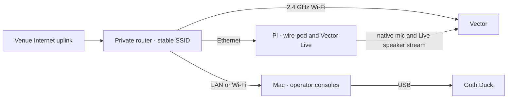

# Event setup: Vector and Goth Duck

## Recommendation

Bring the **known-working Pi, Mac, Duck and a private 2.4 GHz router**. Rehearse on
that same router before leaving; change only its Internet uplink at the venue.
This currently needs less migration work than Mac-only, despite the extra box.

The Pi currently uses Ethernet; its Wi-Fi interface is disconnected. Its services,
pairing, certificates and rollback already work. Duck uses USB for input/output
and needs no additional Wi-Fi provisioning.

## Pi versus Mac

| Option | Proven foundation | Additional work |
|---|---|---|
| Pi wire-pod and Vector Live; Mac Duck | Native microphone, ARM echo processor and local controller deployed; Duck supports USB on Mac | Pi-only voice confirmation and shared acoustic rehearsal; see migration results |
| Pi wire-pod; Mac both voice companions | Separate Duck USB and Vector Wi-Fi transports; host mic pipeline passes offline tests | Choose microphone; rehearse both agents and echo cancellation |
| Mac everything | wire-pod source supports macOS; Mac is arm64 | Install/rehearse Mac wire-pod and libraries; safely migrate pairing/certs; check discovery, privileged ports and recovery |

There is no inherent port or USB ownership conflict between Duck and Vector.
Use separate Python environments because Vector pins older protobuf. Keep the
Duck serial port owned by one process. **Simultaneous acoustic operation is not
tested:** agents can hear and answer one another even with sufficient CPU/network.
Use each robot's own microphone near its participant and rehearse cross-talk.

## Prepare at home

1. Configure a stable private SSID/password and compatible 2.4 GHz Wi-Fi. Disable
   AP/client isolation. Vector cannot complete a captive portal.
   [Manufacturer requirements](https://support.anki.bot/article/104-troubleshooting-vectore28099s-connection).
2. Connect Pi by Ethernet and Mac to the same LAN. Provision Vector's Wi-Fi with
   the existing Bluetooth/web setup while preserving data/pairing. Do not erase
   the robot merely to change Wi-Fi.
3. Reserve DHCP addresses if possible. Choose a LAN subnet that differs from the
   venue uplink; do not depend on current home addresses10.0.0.212/10.0.0.91.
4. Verify `escapepod.local` resolves to Pi. EP firmware uses that hostname, so
   mDNS or LAN DNS must resolve it. Run one advertiser when evaluating Mac-only.
   [Maintainer explanation](https://github.com/kercre123/wire-pod/issues/335#issuecomment-2147942565).
5. Test OpenAI connectivity from the host over HTTPS/WebSocket. A working local
   clock command or reachable admin page does not prove cloud voice connectivity.
6. Cold-boot the complete setup on the private router and repeat the rehearsal.

Local source confirms wire-pod updates paired robot addresses from the robot's
`_ankivector._tcp` advertisement; this has not been tested on a new LAN yet.
The Mac bridge now accepts `--ssh-target` and defaults to `escapepod.local` rather
than a home-only IP. The Pi companion uses127.0.0.1 for its local wire-pod connection.

## Arrival

- Power the router, establish its uplink and handle any venue login on the
  uplink side using an operator device. Then power Pi and Vector's charger.
- Join Mac to the private LAN. Open [wire-pod](http://escapepod.local:8080) and
  [Vector Voice](http://escapepod.local:8080/vector-live.html); confirm robot,
  mode and microphone source before starting.
- In the existing Duck project run `uv run --locked python -m gothduck`; open
  [Duck's console](http://127.0.0.1:8787). Confirm USB port/input device before joining.
- Test each agent alone, then together: ordinary speech, interruption, speaker
  echo, start/stop, USB reconnect and brief Internet loss. Rehearse30–60 minutes
  at intended seating distance and volume. Keep Mac powered/awake for its services.
- End paid sessions during breaks. Muting input does not close the cloud connection.

## Continuous listening on the Pi

The custom WireOS application now supplies Vector's real internal microphones.
The Pi-native controller, echo worker and cloud transport remove the Mac
requirement for Vector. The Mac still runs Duck over USB. Voice stays off until
explicit web-admin Start; the idle controller can run across boots. See
[PI_MIGRATION.md](PI_MIGRATION.md) for the current deployment and measured results.

The original host-microphone prototype remains available as development fallback.
It is no longer the intended event microphone path. Echo delay and interference
between Duck and Vector still need rehearsal in the intended room arrangement.

## Optional physical controls

Use the web admin as the primary control for the event. The companion already
listens for a sustained back-touch rise as a stop request; its threshold and
timing still need a physical rehearsal. It does not start sessions from touch.
Losing the robot-state event stream closes the session rather than dropping the
stop control silently.

A double tap is the preferred next optional start/stop gesture: measure the
untouched baseline, use hysteresis and about60 ms debounce, require two short
press/release cycles within roughly600 ms, then apply a two-second cooldown.
Those values are proposed tuning, not measured reliability. An idle state-only
watcher could start the same controller, with no movement commands; keep that
watcher disabled until rehearsed so casual handling does not open a paid session.

Arm lift/lower is lower priority. We would need to distinguish deliberate manual
patterns from normal arm animation using measured lift-angle events. That path
has not been calibrated or implemented. It adds event-demo complexity without
improving on the web control enough to justify making it the first choice.
