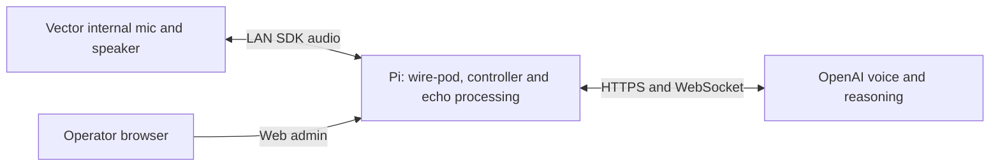

# Vector Live on the Pi

Deployment: October19,2026. The Pi runs wire-pod, the local voice controller,
Vector SDK/native microphone input, WebRTC echo processing and the OpenAI Live
connection. The Mac is an operator/development computer; it does not carry
Vector's audio or cloud connection. Duck remains a separate USB app on the Mac.



## Runtime

- Pi: Debian13.2aarch64, four-core Cortex-A72,906MiB available physical RAM.
- `/home/pi/vector-live-native`: current source release.
- `/home/pi/vector-live-app/.venv`: existing SDK/protobuf3 Python3.13 environment.
- `/home/pi/vector-native-audio`: isolated LiveKit1.1.18/protobuf7 environment.
  Native mode uses no PortAudio or external microphone.
- `/home/pi/vector-live-app/.env`: previously approved key, unchanged,pi-owned0600.
- `vector-native-controller.service`: idle controller, enabled on boot.
- `/home/pi/vector-live-runtime/control.sock`: Pi-local Unix control socket in
  a0700directory, socket0600. No SSH tunnel or additional TCP port.
- `vector-live.service`: original wake-word companion, preserved and on demand.
- Admin: `http://escapepod.local:8080/vector-live.html`. Existing JSON/header and
  same-origin checks remain. Start opens the selected bounded session; Stop ends
  it. The controller itself opens neither mic nor paid session while idle.

The new service runs as `pi` with read-only home/system protection and a private
`/tmp`. Child input and speaker queues are bounded. Fresh native input is checked
before paid startup. SDK control is released after mic/speaker cleanup and before
waiting for cloud finalization. A crash/restart returns the controller to idle;
it does not reopen a paid conversation.

## Robot application

WireOS3.0.2.35d/compatibility209 uses the previously tested candidate at
`/anki-continuous-candidate`. `vector-native-mic.service` verifies all four pinned
core hashes and mounts it over `/anki` before the robot application services on
boot. The original stock application remains underneath, and root stays
read-only. The unit requires the data mount so its script is available.
There is no automatic five-minute rollback timer in this installation.

The complete source change is in `firmware/continuous-mic.patch`, pinned to
os-vector/wire-os-victor commit8fc055ac5c7538601a319149fb62275207719140.
The build manifest, queue tests and native capture evidence are versioned;
firmware images, build trees, SSH keys and pairing data are excluded.

## Validation

- All45companion offline tests passed on the Pi, including actual isolated ARM
  echo processing and local controller socket lifecycle.
- One-minute native input/APM/simulated upload test:594source groups/59.4nominal
  seconds, zero group discontinuities,5940processed10msframes.
- Maximum simulated upload lateness5.72ms; maximum queued input240ms.
- Main process peak84,100KiB; worker peak47,732KiB. Main process CPU10.52%of
  one core over66.7wall seconds; worker CPU was not separately measured.
-107upload frames needed silence padding because source/delivery clocks do not
  exactly match the nominal16kHz upload clock. There were no missing source groups.
  This is not proof of long-duration clock stability.
- Pi synthetic speech through ARM APM and Live:12second bound,11seconds confirmed
  final usage, audio returned, no API error, no room mic or audible playback.
- Robot reboot: persistent unit and application services active; loaded microphone
  executable and mapped engine library match candidate; root read-only; no
  rollback timer. Original pairing and server routing retained.

The attended Pi-only conversation outcome and final installed settings are
recorded in `PI_MIGRATION_RESULT.json`. Deliberate interruption, calibrated echo
suppression, longer sessions and Duck cross-talk still need dedicated rehearsal.

The first Go test attempt used unrestricted compilation and coincided with slow
SSH acceptance; it was interrupted. Further builds use `GOMAXPROCS=2` and `-p1`,
separately from audio rehearsals. Do not confuse compiler resource use with the
measured audio runtime.

## Operations and recovery

```sh
# Pi: controller is unpaid and idle until web Start.
sudo systemctl status vector-native-controller.service
sudo systemctl restart vector-native-controller.service
# Stop controller and its active child, if any.
sudo systemctl stop vector-native-controller.service
```

Pi pre-migration source/service backup:
`/home/pi/vector-native-backups/20261019-before-pi-native/`.
The original wire-pod installation and earlier complete backup are preserved.
To return to the previous Mac controller, first stop/disable the Pi controller,
then start the Mac controller with the existing private socket forward. Do not
run both owners for the same control socket.

Robot manual stock recovery, using the existing private SSH access:

```sh
mount -o remount,rw /
systemctl disable vector-native-mic.service
mount -o remount,ro /
reboot
```

Disable the persistent unit before using the older rollback helper; otherwise
its reboot fallback will correctly load the persistent native application again.
Do not unmount `/anki` while robot services use it. Stock recovery is manual;
ordinary Live Stop keeps the native microphone application installed.


## First attended trial and clock correction

The first Pi-only trial completed six speaker segments. The owner heard glitched
speech and reported it lost track after a while. It closed on an echo-worker
failure, with58seconds final usage confirmed. There was no kernel OOM entry.
A silent native-capture test with a continuous synthetic render reference then
reproduced the worker's exact `Invalid or excessive speaker reference` failure
after39.14wall seconds, with zero source-group gaps and a3.9ms worst upload-clock
late wake. This is evidence of reference clock accumulation rather than proof
that Pi CPU or network performance caused the audible glitches.

The original adapter treated each group as exactly100ms even though robot
source timestamps repeatedly span101–102ms. `native_clock.py` now interpolates
sample groups to their measured timestamp intervals before AEC and upload.
It buffers one group of lookahead, keeps sample order and rejects discontinuous
or implausible timestamp intervals. It does not enlarge the reference buffer or
silently discard input. Tests cover waveform endpoints, continuous signal,
long-run sample totals, timestamp wraparound and invalid intervals. Worker
failures now report bounded internal diagnostics with no room speech content.

The corrected two-minute silent reference test and attended result are recorded
in `PI_MIGRATION_RESULT.json`; do not claim the voice quality fixed until that
physical rehearsal succeeds.


## Corrected silent stress result

The two-minute native capture plus continuous synthetic render-reference test
passed with the original one-second reference bound:1184source groups, zero
group gaps,12,036processed10msframes and no worker error. Measured timestamp
intervals were99–104ms. The upload clock's maximum late wake was11.64ms;
maximum queued input was310ms. Only12of12,001upload frames needed silence
padding, compared with85of3,745before the old adapter failed. Peak main/worker
memory remained84,560/47,856KiB; main CPU was15.5%of one core. This validates
clock alignment under the silent reference load, not acoustic echo suppression
or perceived voice quality.

To deploy updated companion source on this Pi, copy the top-level Python files,
`pyproject.toml` and the controller unit into `/home/pi/vector-live-native`.
Keep the key at its existing approved path. Install the isolated worker with:

```sh
python3 -m venv /home/pi/vector-native-audio
/home/pi/vector-native-audio/bin/python -m pip install -r native-audio-requirements.txt
sudo install -m644 vector-native-controller.service /etc/systemd/system/
sudo systemctl daemon-reload
sudo systemctl enable --now vector-native-controller.service
```

Run companion tests from the source directory with
`VECTOR_AUDIO_TEST_PYTHON=/home/pi/vector-native-audio/bin/python /home/pi/vector-live-app/.venv/bin/python -m pytest -q`.
Test discovery is scoped to `tests` so the separate firmware vendor tree is not
mistaken for companion tests. The legacy SDK environment's pinned packages are
listed in `requirements.txt`; the modern worker pins are separate.


## Boot and final service state

The Pi was rebooted after installation. wire-pod and the native controller both
returned, the private socket was available, and the admin reported legacy/off,
continuous available, no active mic and no paid child. The initial90-second
attended trial configuration was then replaced with the versioned service's
normal600-second maximum at volume80. The unpaid controller was restarted and
remains off until explicit Start. The original wake service is preserved.

The wire-pod audiotap, config-ws and preqs Go packages passed tests using the
existing root toolchain/cache and documented Vosk flags, with compilation
limited to two scheduler threads and one build job. Pi source matches the fork;
the single mismatch was comment wording and was synchronized without rebuilding
or replacing the working Go executable. No new Go behavior was required for the
Pi-local controller migration.

Corrected audible voice quality and spoken exit remain an owner-present check;
no additional audible test is started without a current readiness response.
