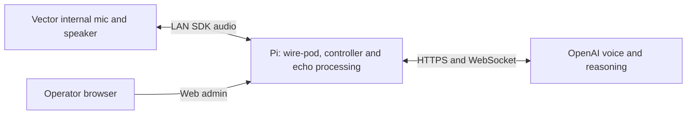

# Vector Live on the Pi

Deployment: October19,2026. The Pi runs wire-pod, the local voice controller,
Vector SDK/native microphone input, WebRTC echo processing and the OpenAI Live
connection. The Mac is an operator/development computer; it does not carry
Vector's audio or cloud connection. Duck remains a separate USB app on the Mac.



## Runtime

- Pi: Debian13.2aarch64, four-core Cortex-A72,906MiB available physical RAM.
- `/home/pi/vector-live-native`: current source release.
- `/home/pi/vector-live-app/.venv`: existing SDK/protobuf3 Python3.13 environment.
- `/home/pi/vector-native-audio`: isolated LiveKit1.1.18/protobuf7 environment.
  Native mode uses no PortAudio or external microphone.
- `/home/pi/vector-live-app/.env`: previously approved key, unchanged,pi-owned0600.
- `vector-native-controller.service`: idle controller, enabled on boot.
- `/home/pi/vector-live-runtime/control.sock`: Pi-local Unix control socket in
  a0700directory, socket0600. No SSH tunnel or additional TCP port.
- `vector-live.service`: original wake-word companion, preserved and on demand.
- Admin: `http://escapepod.local:8080/vector-live.html`. Existing JSON/header and
  same-origin checks remain. Start opens the selected bounded session; Stop ends
  it. The controller itself opens neither mic nor paid session while idle.

The new service runs as `pi` with read-only home/system protection and a private
`/tmp`. Child input and speaker queues are bounded. Fresh native input is checked
before paid startup. SDK control is released after mic/speaker cleanup and before
waiting for cloud finalization. A crash/restart returns the controller to idle;
it does not reopen a paid conversation.

## Robot application

WireOS3.0.2.35d/compatibility209 uses the previously tested candidate at
`/anki-continuous-candidate`. `vector-native-mic.service` verifies all four pinned
core hashes and mounts it over `/anki` before the robot application services on
boot. The original stock application remains underneath, and root stays
read-only. The unit requires the data mount so its script is available.
There is no automatic five-minute rollback timer in this installation.

The complete source change is in `firmware/continuous-mic.patch`, pinned to
os-vector/wire-os-victor commit8fc055ac5c7538601a319149fb62275207719140.
The build manifest, queue tests and native capture evidence are versioned;
firmware images, build trees, SSH keys and pairing data are excluded.

## Validation

- All45companion offline tests passed on the Pi, including actual isolated ARM
  echo processing and local controller socket lifecycle.
- One-minute native input/APM/simulated upload test:594source groups/59.4nominal
  seconds, zero group discontinuities,5940processed10msframes.
- Maximum simulated upload lateness5.72ms; maximum queued input240ms.
- Main process peak84,100KiB; worker peak47,732KiB. Main process CPU10.52%of
  one core over66.7wall seconds; worker CPU was not separately measured.
-107upload frames needed silence padding because source/delivery clocks do not
  exactly match the nominal16kHz upload clock. There were no missing source groups.
  This is not proof of long-duration clock stability.
- Pi synthetic speech through ARM APM and Live:12second bound,11seconds confirmed
  final usage, audio returned, no API error, no room mic or audible playback.
- Robot reboot: persistent unit and application services active; loaded microphone
  executable and mapped engine library match candidate; root read-only; no
  rollback timer. Original pairing and server routing retained.

The attended Pi-only conversation outcome and final installed settings are
recorded in `PI_MIGRATION_RESULT.json`. Deliberate interruption, calibrated echo
suppression, longer sessions and Duck cross-talk still need dedicated rehearsal.

The first Go test attempt used unrestricted compilation and coincided with slow
SSH acceptance; it was interrupted. Further builds use `GOMAXPROCS=2` and `-p1`,
separately from audio rehearsals. Do not confuse compiler resource use with the
measured audio runtime.

## Operations and recovery

```sh
# Pi: controller is unpaid and idle until web Start.
sudo systemctl status vector-native-controller.service
sudo systemctl restart vector-native-controller.service
# Stop controller and its active child, if any.
sudo systemctl stop vector-native-controller.service
```

Pi pre-migration source/service backup:
`/home/pi/vector-native-backups/20261019-before-pi-native/`.
The original wire-pod installation and earlier complete backup are preserved.
To return to the previous Mac controller, first stop/disable the Pi controller,
then start the Mac controller with the existing private socket forward. Do not
run both owners for the same control socket.

Robot manual stock recovery, using the existing private SSH access:

```sh
mount -o remount,rw /
systemctl disable vector-native-mic.service
mount -o remount,ro /
reboot
```

Disable the persistent unit before using the older rollback helper; otherwise
its reboot fallback will correctly load the persistent native application again.
Do not unmount `/anki` while robot services use it. Stock recovery is manual;
ordinary Live Stop keeps the native microphone application installed.


## First attended trial and clock correction

The first Pi-only trial completed six speaker segments. The owner heard glitched
speech and reported it lost track after a while. It closed on an echo-worker
failure, with58seconds final usage confirmed. There was no kernel OOM entry.
A silent native-capture test with a continuous synthetic render reference then
reproduced the worker's exact `Invalid or excessive speaker reference` failure
after39.14wall seconds, with zero source-group gaps and a3.9ms worst upload-clock
late wake. This is evidence of reference clock accumulation rather than proof
that Pi CPU or network performance caused the audible glitches.

The original adapter treated each group as exactly100ms even though robot
source timestamps repeatedly span101–102ms. `native_clock.py` now interpolates
sample groups to their measured timestamp intervals before AEC and upload.
It buffers one group of lookahead, keeps sample order and rejects discontinuous
or implausible timestamp intervals. It does not enlarge the reference buffer or
silently discard input. Tests cover waveform endpoints, continuous signal,
long-run sample totals, timestamp wraparound and invalid intervals. Worker
failures now report bounded internal diagnostics with no room speech content.

The corrected two-minute silent reference test and attended result are recorded
in `PI_MIGRATION_RESULT.json`; do not claim the voice quality fixed until that
physical rehearsal succeeds.


## Corrected silent stress result

The two-minute native capture plus continuous synthetic render-reference test
passed with the original one-second reference bound:1184source groups, zero
group gaps,12,036processed10msframes and no worker error. Measured timestamp
intervals were99–104ms. The upload clock's maximum late wake was11.64ms;
maximum queued input was310ms. Only12of12,001upload frames needed silence
padding, compared with85of3,745before the old adapter failed. Peak main/worker
memory remained84,560/47,856KiB; main CPU was15.5%of one core. This validates
clock alignment under the silent reference load, not acoustic echo suppression
or perceived voice quality.

To deploy updated companion source on this Pi, copy the top-level Python files,
`pyproject.toml` and the controller unit into `/home/pi/vector-live-native`.
Keep the key at its existing approved path. Install the isolated worker with:

```sh
python3 -m venv /home/pi/vector-native-audio
/home/pi/vector-native-audio/bin/python -m pip install -r native-audio-requirements.txt
sudo install -m644 vector-native-controller.service /etc/systemd/system/
sudo systemctl daemon-reload
sudo systemctl enable --now vector-native-controller.service
```

Run companion tests from the source directory with
`VECTOR_AUDIO_TEST_PYTHON=/home/pi/vector-native-audio/bin/python /home/pi/vector-live-app/.venv/bin/python -m pytest -q`.
Test discovery is scoped to `tests` so the separate firmware vendor tree is not
mistaken for companion tests. The legacy SDK environment's pinned packages are
listed in `requirements.txt`; the modern worker pins are separate.


## Boot and final service state

The Pi was rebooted after installation. wire-pod and the native controller both
returned, the private socket was available, and the admin reported legacy/off,
continuous available, no active mic and no paid child. The initial90-second
attended trial configuration was then replaced with the versioned service's
normal600-second maximum at volume80. The unpaid controller was restarted and
remains off until explicit Start. The original wake service is preserved.

The wire-pod audiotap, config-ws and preqs Go packages passed tests using the
existing root toolchain/cache and documented Vosk flags, with compilation
limited to two scheduler threads and one build job. Pi source matches the fork;
the single mismatch was comment wording and was synchronized without rebuilding
or replacing the working Go executable. No new Go behavior was required for the
Pi-local controller migration.

Corrected audible voice quality and spoken exit remain an owner-present check;
no additional audible test is started without a current readiness response.


## Continuous voice selection

New sessions query the approved key's `/v1/audio/voices` inventory for the saved
name Vector (case insensitive). The newest matching saved voice is selected by
ID, with its original voice description included in the Live instructions as
recommended in the [custom voice guide](https://developers.openai.com/api/docs/guides/custom-voices).
If no match is visible, or inventory access is unavailable (403/404), sessions
use Stone. Authentication, rate-limit, server and malformed-inventory failures
remain explicit errors. No voice is created or key changed. Selection is fixed
for the session; the next Start checks again. The admin shows the policy while
idle and the selected voice plus fallback reason while ready.

On October19 the Pi's existing key returned an empty saved-voice list, so the
generated Vector voice could not be selected. A silent API-only probe accepted
Stone, closed with final usage of0seconds and no error, and opened no robot
control, microphone or playback. This verifies API acceptance; speaker quality
still needs an attended conversation.93Python tests passed on Mac and Pi; the Go admin,
intent and audio-tap tests passed on Pi. Existing volume100, boost6dB and gesture
settings are preserved. Backup: `20261019-before-voice-choice`.

## Saved continuous voice volume

The web admin now includes a0–100continuous voice slider. The controller saves
`/home/pi/vector-live-runtime/settings.json` atomically with0600permissions.
The current conversation reads changes every200ms, and its heartbeat reports
the applied level separately from the saved setting. The slider stays usable
with Live off and remembers the level across controller restarts. Zero mutes
continuous voice; it does not stop microphone capture or close a paid session.
The legacy wake-word prototype has its own startup volume.

Continuous speech uses fixed full-scale stream preparation plus bounded PCM
attenuation per outgoing frame. The AEC reference receives the accepted PCM
after gain, so changing volume does not create a reference/output mismatch.
The setting needs no cloud-session restart or speaker-stream cancellation.
The native ready cue also respects mute. Python regressions cover0/50/100gain,
mid-stream changes, exact render reference, private persistence, invalid values,
active settings polling and cleanup. Go tests cover the authenticated volume
proxy, range/type checks and rejected cross-origin requests.

The corrected owner-admin rehearsal completed six speaker segments with zero
native group gaps, no echo-worker error,80seconds final usage and clean closure.
The first admin attempt failed before readiness, with zero final usage; the old
exception path omitted its cause. Startup exceptions now preserve their internal
reason in the private status/log instead of printing a misleading null error.
No exact cause is claimed for that earlier failure.


Volume deployment verification:57Python tests passed on both Mac and Pi; the
Go audio/admin/intent packages passed, and the volume-enabled server was built
and activated atomically with its previous binary backed up. In the actual web
page, the slider saved79, retained79after a controller restart and page reload,
and was returned to the owner's80setting. The deployed API rejected101with400
and an unrelated Origin with403. No paid session or playback was opened for
these checks. The live-gain and echo-reference behavior has offline coverage;
perceived level can be checked during the next owner-started conversation.

## Continuous speech boost and initial behavior layer

Added saved admin controls for 0/+3/+6 dB boost and off/eyes/eyes-plus-head
expressions. Volume100 from the owner's settings was preserved. Boost acts on
PCM before accepted speaker samples enter the echo reference; the soft-knee
limiter caps peaks at -1 dBFS. There is no new automatic loudness controller.
The ready cue stays quiet and respects mute.

Expression work runs separately from audio timing. Short-lived 184x96 RGB565
frames renew at2.5fps; speaker-segment starts can request a eight-degree relative
nod with a12-second cooldown. Head gestures need fresh stationary robot state
and stop on pickup/fall/cliff/pathing/wheel movement/control loss or disabling
head mode. Head actions have bounded RPC deadlines and explicit cancellation.
Face errors degrade expressions without closing working voice. No wheel/lift
commands are present. Eventual roaming is documented as a navigation policy
within this coordinator, with a separate motor-noise/obstacle/interruption trial.

Validation before the attended rehearsal:64Python tests passed on Mac and Pi;
config-ws, preqs and audiotap Go tests passed. Tests include mid-stream boost
and mute reaching the exact echo reference, old-volume-file migration,
persistence, pending-head cancellation on pickup and mode change, and session
cleanup. On the Pi, processing60seconds of synthetic PCM with+6dB took0.056s.
The deployed API rejected boost9, unsupported roaming and foreign Origin.
In the actual admin page, +6dB and head expressions saved successfully, survived
an unpaid-controller restart and page reload, and retained volume100. An
independent95-second Pi timer bounds the owner-approved hardware rehearsal.

Backups are in `/home/pi/vector-native-backups/20261019-before-expressions`.
The active robot firmware, original installation and API key were untouched.

The attended rehearsal closed cleanly:87seconds final usage,95seconds elapsed,
five completed speaker segments,200face frames, three SDK-completed four-degree
nods and no voice/expression error. The owner saw green eyes/blinks but did not
notice the small nods. Nods were increased to eight degrees; a separate silent
SDK-control check completed one nod without error, and fresh robot state
measured the head moving from31.45to25.06degrees. This opens no cloud session.

The voice claimed it could not move or blink despite automatic app gestures.
The existing personality required tool-established physical capability; it now
explicitly describes automatic eyes/blinks/head and delegates physical questions
to `get_robot_status`, which returns the current applied profile, eye/blink and
head enablement, current head permission, completed nod count, and unavailable
driving. No spoken driving or explicit blink/nod tool is implied. The final
capability change passes14focused lifecycle/Live configuration tests; visible
prompt adherence still requires a new conversation. No second paid conversation
was opened for that adjustment.

The owner confirmed Live voice was louder and Vector returned to normal mode.
Native transport delivered884groups with zero discontinuities and no echo-worker
error. The larger silent nod is established by SDK completion and measured head
angle; the owner did not separately confirm seeing it. Final blink/head status
and session configuration changes passed14focused tests on both Mac and Pi.
Live remains off; saved settings are volume100,+6dB,eyes-plus-head.

## Expanded gesture controls and legacy-expression installation

Added saved nod depth2–20degrees, automatic nod interval4–30seconds, a separate
legacy-expression switch and a ready-session expression picker. The actual
`perform_expression` tool accepts nod/blink and the11legacy emotion choices;
it reports refusal or completion rather than relying on spontaneous nod timing.
Preview commands use a per-session0600Unix socket, require a fresh matching
ready child, never spawn paid voice, and are removed during cleanup.

The original legacy clips contain RobotAudio, BodyMotion, LiftHeight and other
tracks. The deterministic builder retains only ProceduralFace/HeadAngle tracks,
clamps head angles and records original-member and output SHA256values. Only
new prefixed assets were installed in the persistent candidate; native microphone
binaries, pairing, original clips and API credentials were untouched. Root was
restored read-only. The engine separately loads`assets/anim_manifest.json`; the
installer merges the new entries into that index while preserving all original
entries and saves its before-copy under`/data/vector-live-assets/20261019`.
Both animation and engine services need reloading for the asset/index pair.

The animation reload first waited for its90-second old-process stop timeout,
then recovered to active. SDK enumeration still timed out with control granted.
A silent trial caught a completed SDK result for an unknown name; engine logs
confirmed`AnimationComponent.PlayAnimByName.AnimNotFound`. This exposed the
missing separate engine-index registration, which was then added. Runtime
preflight now uses a known quiet face-only clip and rejects implausibly short
completion. Every expression requires SDK completion and at least70%of the
authored duration; failed clips are removed from the session catalog.

81Python tests passed on both Mac and Pi. Go admin/audio/intent tests passed.
Coverage includes original index preservation, stripped-track/hash validation,
false SDK completion, face arbitration, native cancellation on pickup, explicit
head depth/travel, private request forwarding, stale-child refusal and cleanup.
The deployed API rejected nod21and arbitrary animation names; previews were
refused while Live was off. The browser saved nod14/cadence20, retained them
after controller restart and reload, then restored the prior nod8/cadence12.
Volume100and+6dBboost remain as the owner set them.

Backups: `/home/pi/vector-native-backups/20261019-before-gesture-controls`.
No paid session has been opened for this change. Owner-present native-head
animation overlap with speech, acoustic echo and spoken-tool selection remain
separate rehearsal checks.

The gateway uses a shared SDK completion channel. An initial post-grant request
ended after33ms, while an800mssettling wait produced plausible playback. A stale
ordinary-animation completion is a possible cause, not a confirmed one. Runtime
now waits800msbefore preflight and matches the reported animation name as well
as result/duration. All ten unique quiet clips subsequently completed the
silent face-only check at plausible authored lengths; verySad aliases sad.

Final validation:82Python tests passed on Mac and Pi. The silent SDK check
validated all11choices (ten unique clips), matching returned names and plausible
authored duration with every motor track ignored. Results are recorded in
`PI_MIGRATION_RESULT.json`. Expression-off suppresses startup probing; enabling
legacy during a session prepares the catalog when the behavior/speaker slot is
quiet. The admin leaves nod8/cadence12, legacy enabled, volume100and+6dB.
No OpenAI session was opened; microphone/ordinary autonomy control was released.
Legacy-head overlap with Live speech and model-selected tools remain attended
checks, rather than claims established by the silent face-only run.

## Natural behavior, arms and wheels

The deployed controller now supports `autonomy` (boolean, next Start) and
`motion` (`off`, `arms`, `full`, live). Natural mode keeps the ordinary Vector
behavior tree active between requested gestures: no session-wide SDK control
and no automatic RGB face replacement. Each requested SDK gesture temporarily
acquires DEFAULT control, waits for cancellation/state updates, then releases.

Verified directly on the robot: `SDKDefault.json` has control level20 and
`disableCliffDetection:false`. The old OVERRIDE_BEHAVIORS priority selected
SDKOverrideAll, which disables native cliff stopping; all Live control leases
now use DEFAULT. No robot files or binaries were changed for this feature.

The private command socket, web expression picker and spoken `perform_motion`
tool support lift height, wave, short signed rolls and turns. SDK requests use
finite deadlines and zero retries, with fresh-state, pickup, cliff, charger,
lift-position and forward-range guards. The supervisor polls every50ms during
motion. Completion also requires measured lift/pose/heading confirmation.
Spoken stop/end requests bypass pending ordinary tool work; cancellation stops
motors before releasing temporary control. A natural-mode preference change
during a session shows as pending until Stop/Start.

Hardware evidence before the attended Live trial:

- Native mic and muted speaker playback worked concurrently without behavior
  control:48real groups,4.8seconds, zero group discontinuities, no paid session.
- The owner confirmed the attended wave and50mmforward roll were visible.
  Both also passed SDK and physical state checks and released control.
-113Python tests passed on Mac and Pi; Go admin/intent/audio-tap tests passed.
  A subsequent wrapped-heading turn test passed locally.

Saved configuration: natural behavior enabled, arms/wheels enabled, existing
volume100and+6dBboost preserved, head profile and quiet legacy clips preserved.
Backup: `/home/pi/vector-native-backups/20261019-before-motion`.

Natural autonomous travel follows Vector's own policies, rather than the
100mmforward/50mmreverse/90degreebounds on explicit SDK commands. Reverse has
no rear range sensor. Stop Live-requested action cancels the explicit action;
ordinary behavior resumes. General navigation, directed object manipulation
and finding the charger are not exposed as Live tools. Combined speech,
motor-noise AEC and native autonomous vocalizations need attended assessment.

Attended Live result: the owner reported the lower-volume experience worked
much better. A user-started conversation invoked `perform_motion` twice; status
confirmed a completed lift to100percent and a completed roll during Live. That
session finalized after58paid seconds with a microphone-helper/queue error.
It had649source groups, zero missing groups and no worker-reported error.
The old combined error string does not establish whether the fault was a
processed-frame stall or input queue overflow. This remains an open reliability
issue; no claim is made that it is fixed. Diagnostics now distinguish those
causes and record peak queue size, network-send time and upload-clock lateness.

The follow-up offline90secondnatural-mode probe passed with synthetic echo
reference:889groups, zero gaps, maximum input queue300ms, maximum simulated
upload lateness11.96ms, worker error null. A subsequent quiet Live diagnostic
finalized93paid seconds with no error, zero missing groups, peak input queue
860ms, maximum send4.5ms and upload lateness4.0ms. An admin-triggered wave
completed and released SDK control during that connection. That quiet diagnostic
had no audible model playback and therefore does not prove sustained spoken
conversation or motor-noise echo suppression. Metadata is preserved privately
on the Pi in `natural-live-diagnostic.json` and mirrored in the local ignored
firmware logs. No audio or transcripts were recorded.

Final checks:116Python tests passed on Mac and Pi, covering distinct stall/overflow
diagnostics, natural ownership, bounded motion, cancellation and wrapped-heading
verification. All Pi/controller changes are reversible using the backup above.
The app did not change the owner's sound settings during volume clarification.
